# CineVerse

<div align="center">

### A cinematic social network where every product action can be followed all the way down to the database.

[](https://nextjs.org/)
[](https://www.typescriptlang.org/)
[](https://www.postgresql.org/)
[](https://tailwindcss.com/)

**Discover films · publish reviews · curate collections · inspect the SQL beneath every interaction**

</div>

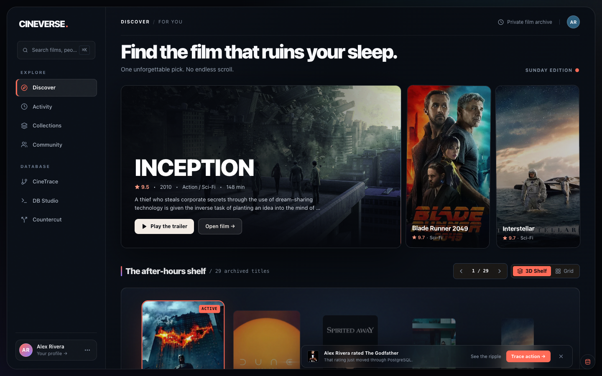

## Beyond another movie app

CineVerse combines a polished film-discovery product with a hands-on database laboratory. The public-facing experience feels like a premium streaming editorial: cinematic artwork, social activity, curated collections, profiles, and responsive mobile layouts. Underneath it, the application exposes the real relational work through three purpose-built experiences:

- **CineTrace** replays a real review mutation from API request to transaction, trigger, audit event, and commit.
- **DB Studio** turns joins, views, functions, triggers, and the schema itself into an interactive workspace.
- **Countercut** creates evidence-grounded arguments about a user's movie taste and requires explicit consent before changing a watchlist.

CineTrace and DB Studio display real database records and query results. The contextual Query Journey / Query Lens explanations are illustrative SQL interpretations rather than authenticated physical execution plans.

## The signature experiences

### CineTrace — mutation provenance you can actually follow

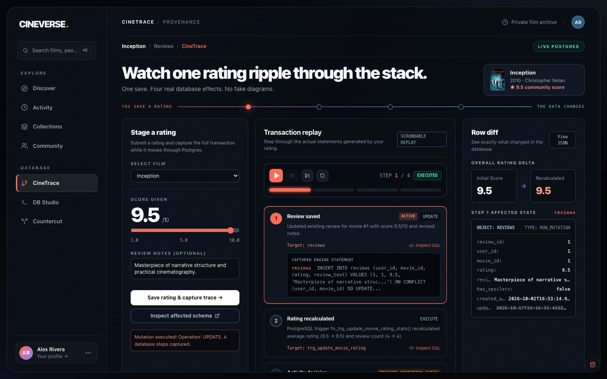

Save a rating and CineTrace reveals the complete chain: validation, `BEGIN`, row mutation, aggregate-rating trigger, activity-log trigger, trace persistence, and `COMMIT`. Each step includes its SQL, duration, affected rows, and before/after state.

### Schema Observatory — the whole relational system in motion

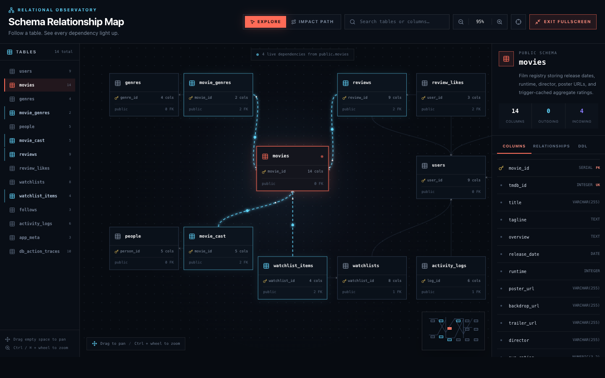

The schema map is a zoomable, pannable, fullscreen relationship canvas. Search or select a table to isolate its neighborhood, inspect column types and keys, and follow animated foreign-key paths without leaving the application.

### Countercut — an agent that argues from evidence

<table>
  <tr>
    <td width="50%">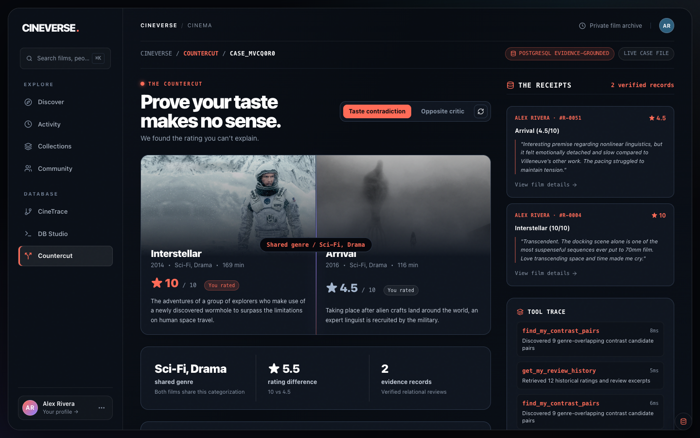</td>
    <td width="50%">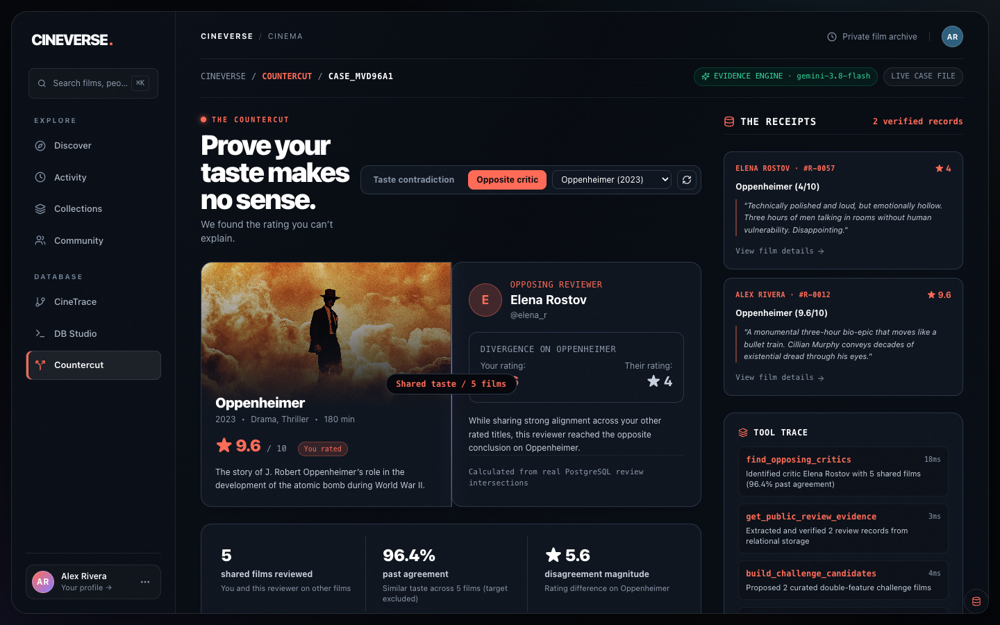</td>
  </tr>
</table>

Countercut investigates a viewer's rating history, genre patterns, social signals, and outliers. It assembles a case instead of producing generic recommendation copy: evidence cards expose the underlying records, confidence is visible, and any consequential action pauses for confirmation.

### DB Studio — SQL as a product experience

<table>
  <tr>
    <td width="50%">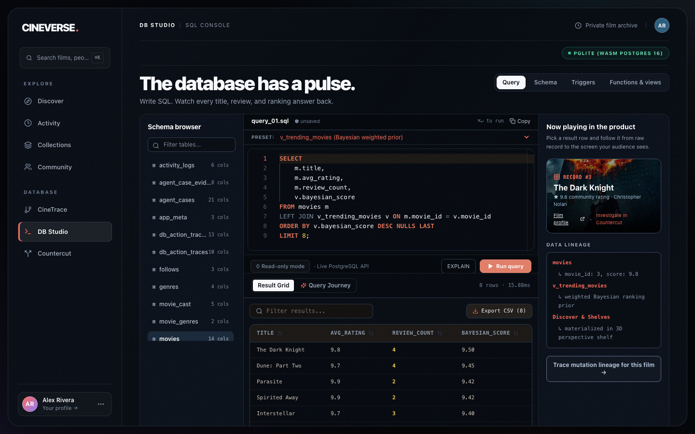</td>
    <td width="50%">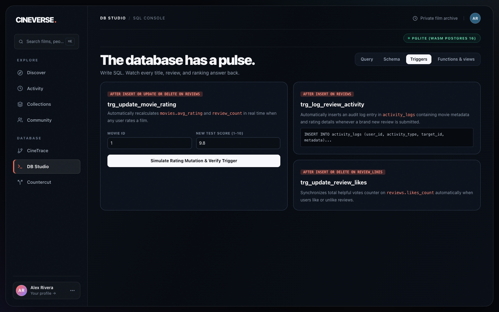</td>
  </tr>
</table>

Write **read-only** SQL in a Monaco-powered editor, launch curated investigations, and inspect responsive result tables. The Trigger Lab performs real review mutations only when explicitly enabled on a disposable local development database.

## Product capabilities

| Experience | What it does | Database ideas made visible |
| --- | --- | --- |
| Discover | Editorial hero, genre filters, trending ranks, and an interactive 3D poster shelf | Views, Bayesian ranking, aggregation |
| Movie detail | Cast, metadata, reviews, ratings, and watchlist actions | Joins, constraints, transactions |
| Community | Activity feed, leaderboard, follows, profiles, and public lists | Social graph, window functions, audit logs |
| CineTrace | Replays a production mutation step by step | ACID, triggers, JSONB, provenance |
| DB Studio | Runs read-only SQL and visualizes schema and trigger behavior | Logical query structure, functions, views, foreign keys |
| Countercut | Builds tentative taste arguments from stored evidence | Multi-stage reads, evidence links, consent gates |
| Query Lens | Shows documented example query patterns behind product views | SQL literacy and query transparency |

## Relational design

The core model is normalized and backed by PostgreSQL-compatible constraints, foreign keys, cascading behavior, triggers, views, and stored functions. Supporting trace and evidence tables make the database observability features durable rather than simulated.

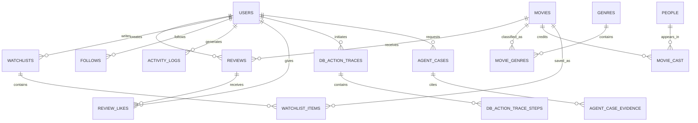

Notable database behavior includes:

- `trg_update_movie_rating` recalculates aggregate rating statistics after review changes.
- `trg_log_review_activity` and `trg_log_watchlist_add` write structured activity events.
- `trg_update_review_likes` keeps denormalized counters consistent.
- `fn_recommend_movies` ranks unseen films using a viewer's genre affinity.
- `fn_get_user_analytics` returns watch time, score distribution, and favorite genres.
- `v_trending_movies`, `v_user_leaderboard`, and `v_genre_performance` package analytical queries for product surfaces.

## Architecture

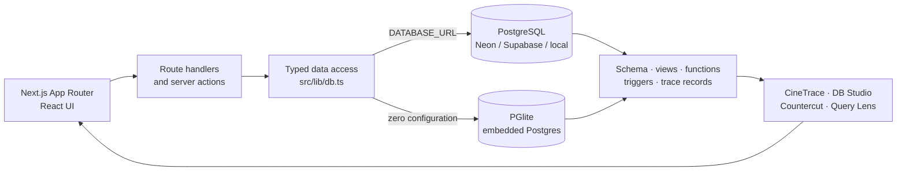

The same application can run against an embedded PGlite database or an external PostgreSQL instance. That keeps first-run setup tiny while preserving the SQL features the product is designed to demonstrate.

## Stack

| Layer | Technology |
| --- | --- |
| Application | Next.js 14 App Router, React 18, TypeScript 5 |
| Interface | Tailwind CSS, Framer Motion, Lucide, cmdk |
| Data workbench | Monaco Editor |
| Database | PostgreSQL or embedded PGlite |
| Validation and AI | Zod, Google GenAI integration |
| Quality | TypeScript, ESLint, custom 71-check QA suite |

## Run locally

Requirements: Node.js 18.17+ and npm.

```bash
git clone https://github.com/sahib-1030/new_cineverse_sahib.git
cd new_cineverse_sahib
npm install
cp .env.example .env.local
npm run dev
```

Open [http://localhost:3000](http://localhost:3000). CineVerse uses PGlite automatically when `DATABASE_URL` is not set, so an external database is optional.

### Environment variables

| Variable | Required | Purpose |
| --- | --- | --- |
| `DATABASE_URL` | No | Connect to PostgreSQL instead of the embedded PGlite database |
| `SESSION_SECRET` | Recommended | Signs application sessions; use a long random value outside local development |
| `GEMINI_API_KEY` | No | Enables live model-backed Countercut generation |
| `GEMINI_MODEL` | No | Overrides the configured Gemini model |
| `ENABLE_DBMS_SQL_CONSOLE` | No | Explicitly enables read-only interactive SQL on trusted production deployments (disabled otherwise) |
| `ENABLE_DBMS_DEMO_MUTATIONS` | No | Allows real Trigger Lab mutations **only in local development** when set to `true` |
| `ALLOW_DEMO_LOGIN` | No | **Unsafe in public production**: re-enables shared seeded demo account logins; do not set on public servers |

The local seed contains shared demonstration accounts. They are disabled on production deployments by default; use the local fixture for classroom demos. Never enable shared demo credentials on a public deployment.

### Useful commands

| Command | Purpose |
| --- | --- |
| `npm run dev` | Start the development server |
| `npm run build` | Create a production build |
| `npm run lint` | Run lint checks |
| `npm test` | Run the repository QA verification suite |
| `npm run db:reset` | Recreate and reseed the local database |
| `npm run db:fixture` | Load the deterministic demo fixture (local disposable database only) |
| `CINEVERSE_SCREENSHOT_DISPOSABLE=true node scripts/capture-all-screenshots.js` | Recapture gallery **only against localhost with a disposable demo database**; investigations can persist new cases |

## Project map

```text
src/app/                 Next.js pages and API route handlers
src/components/          Product UI, cinematic system, and DB experiences
src/lib/                 Database access, authentication, traces, and agents
db/                      Schema, views, triggers, functions, and seed data
scripts/                 Database, QA, and screenshot automation
screenshots/             Versioned product tour images
```

## Complete product gallery

<details>
<summary><strong>Open all desktop and mobile screenshots</strong></summary>

### Discovery — desktop


### Discovery — mobile
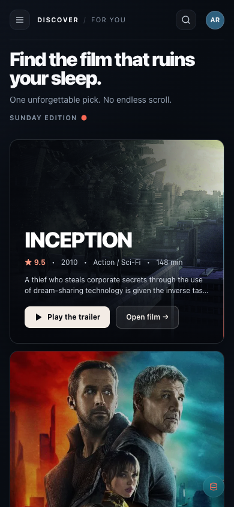

### Movie detail
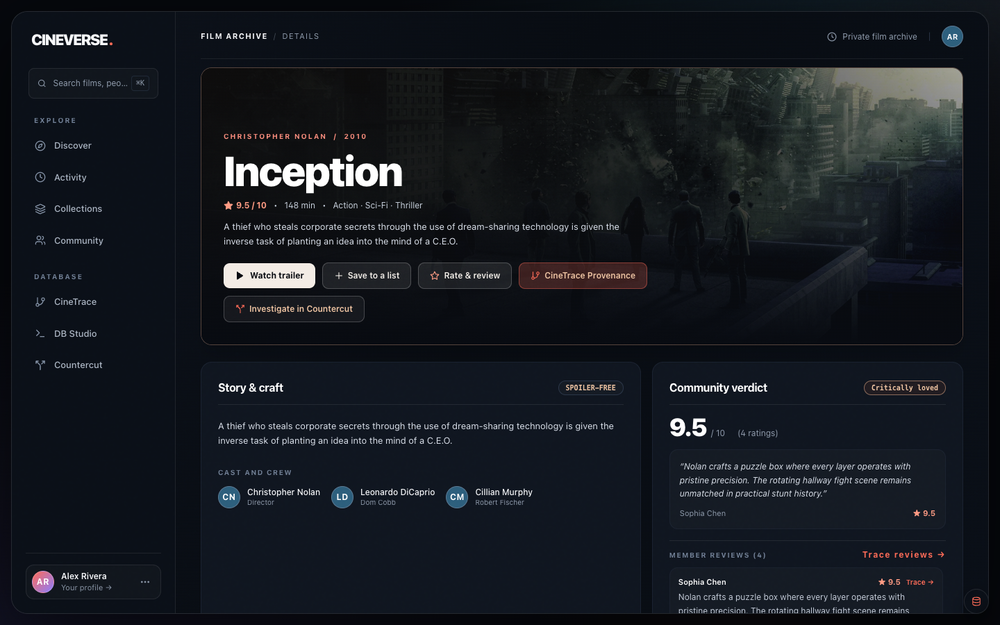

### Community activity
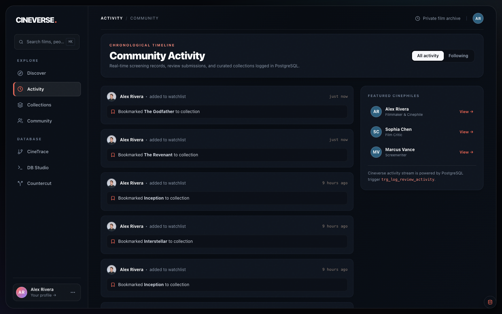

### Curated collections
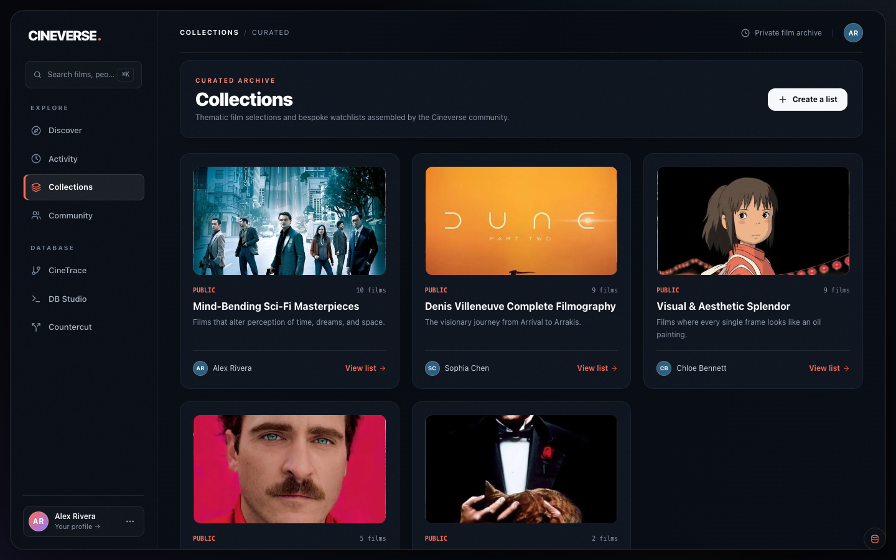

### Collection detail
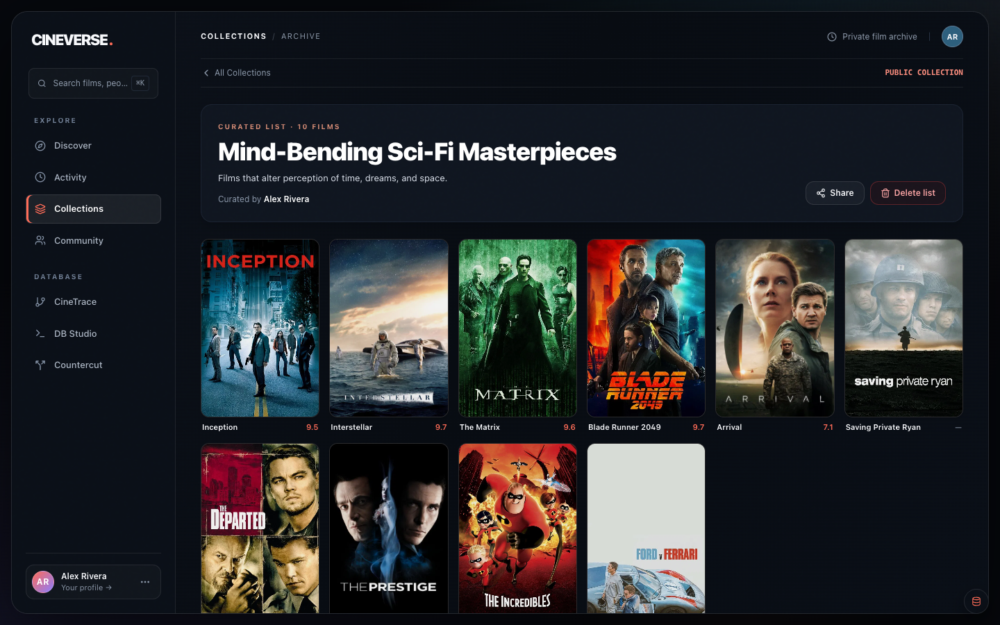

### Community leaderboard
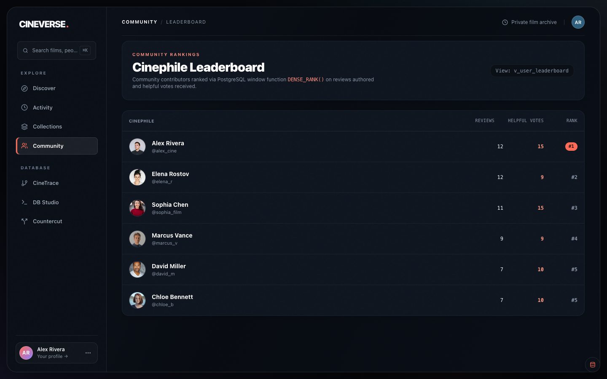

### Member profile
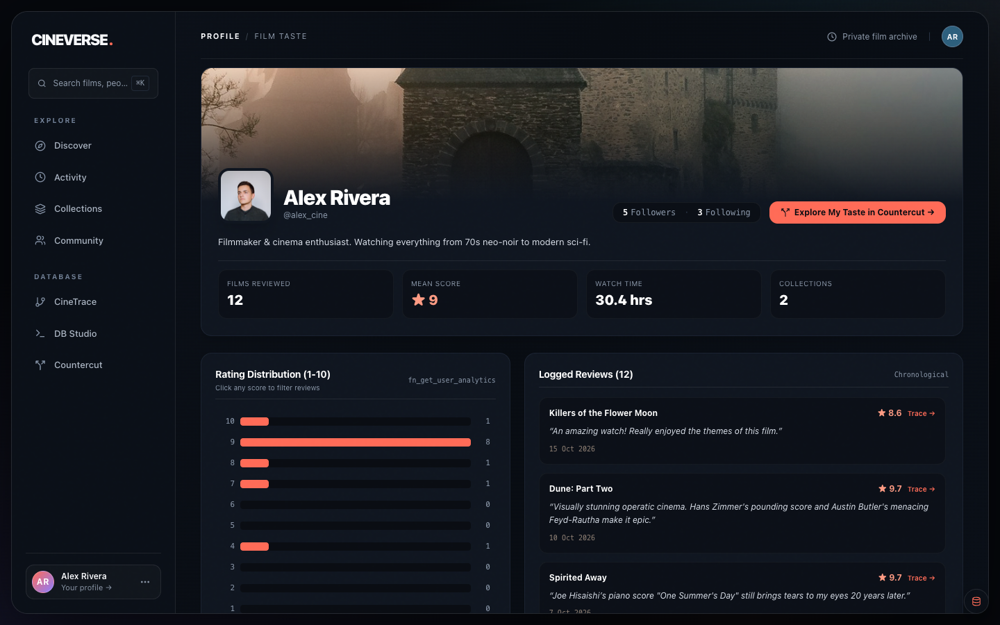

### Sign in
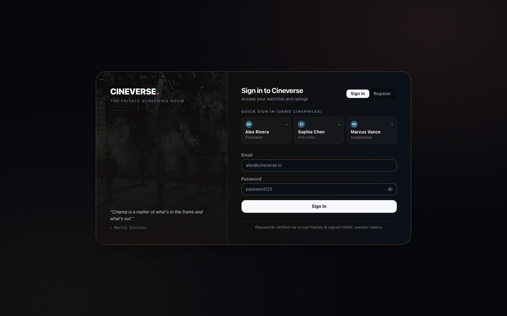

### Create an account
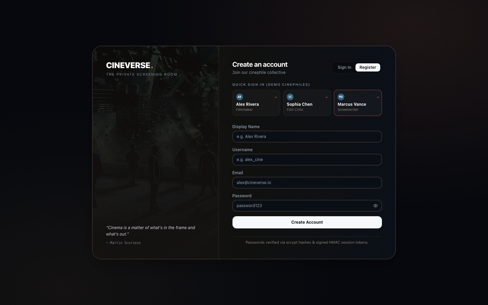

### Query Lens
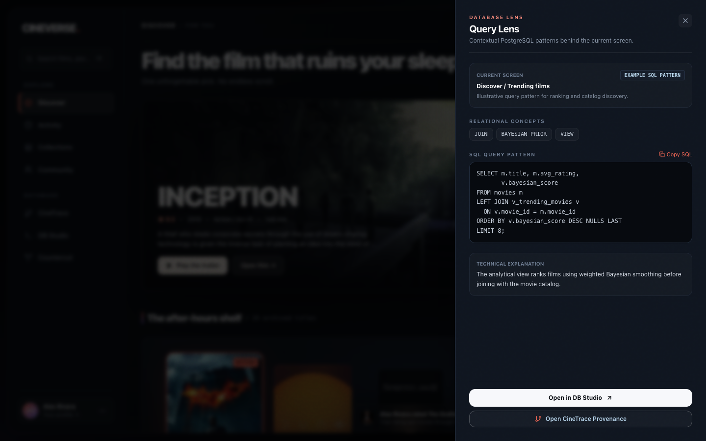

### Countercut — mobile
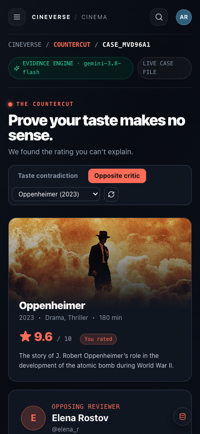

### Countercut action confirmation
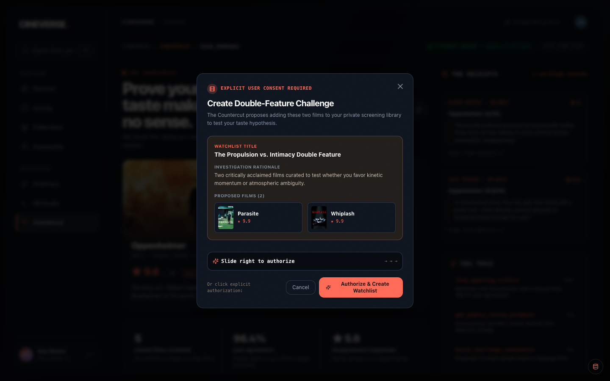

</details>

---

<div align="center">

Built to make the invisible part of a database-backed product feel tangible.

</div>
